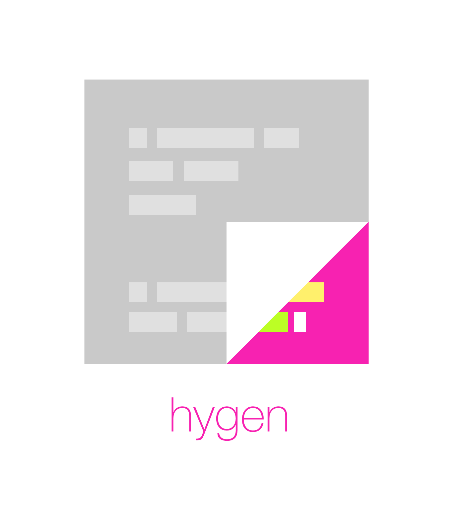
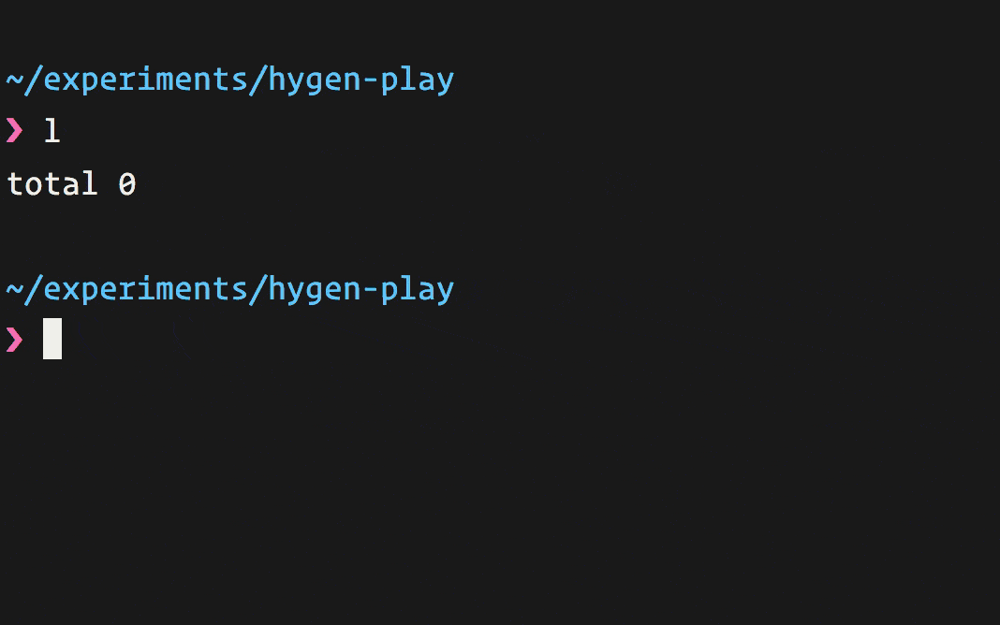

<h3 align="center">
  
</h3>

[](https://travis-ci.org/jondot/hygen)
[](https://www.npmjs.com/package/hygen)

`hygen` is the simple, fast, and scalable code generator that lives _in_ your project.

<div align="center">
  
</div>


## Features

- ✅ Build ad-hoc generators quickly and full on project scaffolds.
- ✅ Local generators per project (and global, if you must)
- ✅ Built-in scaffolds to quickly create generators
- ✅ Full logic templates and rendering
- ✅ Prompts and flows for taking in arguments
- ✅ Automatic CLI arguments
- ✅ Adding new files
- ✅ Injecting into existing files
- ✅ Running shell commands
- ✅ Super fast, constantly optimized for speed


> New in hygen v4.0.0: a positional `NAME` parameter.
> Now you can use `$ hygen component new MyComponent` instead of `$ hygen component new --name MyComponent`.

## Used By

<Image alt="Wix" height="32" src="https://upload.wikimedia.org/wikipedia/en/7/76/Wix.com_website_logo.svg"/> &nbsp; &nbsp; <Image alt="Airbnb" height="50" src="https://upload.wikimedia.org/wikipedia/commons/thumb/6/69/Airbnb_Logo_B%C3%A9lo.svg/512px-Airbnb_Logo_B%C3%A9lo.svg.png"/> &nbsp; &nbsp; <Image alt="Mercedes Benz AG" height="60" src="https://upload.wikimedia.org/wikipedia/commons/thumb/9/9e/Mercedes-Benz_Logo_2010.svg/320px-Mercedes-Benz_Logo_2010.svg.png"/> &nbsp; &nbsp; <Image alt="Open Data Institute" height="60" src="https://luminategroup.com/storage/538/c/opendatainstitute%28ODI%29-logo%402x-logo.png"/> &nbsp; &nbsp;  <Image alt="Ableneo" height="80" src="https://www.ableneo.com/web/images/logo.svg"/> &nbsp;
<Image alt="City of Amsterdam" height="70" src="https://avatars3.githubusercontent.com/u/14022058?s=200&v=4"/> &nbsp; &nbsp; <Image alt="Accenture" height="80" src="https://upload.wikimedia.org/wikipedia/commons/thumb/c/cd/Accenture.svg/512px-Accenture.svg.png"/>  &nbsp; <Image alt="Birdie" height="60" src="https://assets.website-files.com/5d07a11d8195605723dbff07/5d09430b3d6e1c5d28a6e2b6_global%E2%80%94birdie_logo_black.svg"/> &nbsp; &nbsp;
<Image alt="Kind" height="80" src="https://madebykind.com/dist/images/logos/site-logo-green-e0e983ec46.svg"/> &nbsp; &nbsp;  <Image alt="Ackee" height="80" src="https://avatars3.githubusercontent.com/u/1728223?s=400&v=4"/> &nbsp;
 <Image alt="Aerian Studios" height="80" src="https://www.aerian.com/img/c/aerian-logo.svg"/> &nbsp;<Image alt="Food and Agriculture Organization of the UN" height="100" src="https://avatars2.githubusercontent.com/u/38506195?s=200&v=4"/> <Image alt="Cape Cod Commision" height="70" src="http://www.capecodcommission.org/gfx/home-logo.jpg"/> &nbsp; <Image alt="Tweak Things" height="80" src="https://avatars3.githubusercontent.com/u/49718812?s=400&v=4"/> &nbsp; &nbsp; <Image alt="Crema" height="40" src="https://assets.website-files.com/5b6b50e79e9b6f5948395973/5d88f52b42420350d3e117d2_Asset%201.png"/> &nbsp; &nbsp; <Image alt="Cureon" height="120" src="http://cureon.de/resources/cureon_logo.png"/> &nbsp; &nbsp; <Image alt="Astrocoders" height="50" src="https://d33wubrfki0l68.cloudfront.net/b8f71088a0c9bc92d67476a361f35690d157d0e5/517c2/static/logo-c5d890fb431b53a7c61800feccd65ac2.png"/> &nbsp; &nbsp; <Image alt="Vega/IDL" height="60" src="http://vega.github.io/images/idl-logo.png"/> &nbsp; <Image alt="Sporty Spots" height="60" src="https://www.sportyspots.com/static/sportyspots.svg"/> &nbsp; &nbsp;<Image alt="Thrashplay" height="50" src="https://avatars1.githubusercontent.com/u/55868193?s=200&v=4"/> &nbsp;&nbsp;<Image alt="8base" height="80" src="https://avatars1.githubusercontent.com/u/28789399?s=200&v=4"/> &nbsp;&nbsp; <Image alt="Instamotionh" height="50" src="https://avatars1.githubusercontent.com/u/44466967?s=200&v=4"/>  <Image alt="Biotope" height="90" src="https://avatars1.githubusercontent.com/u/34653144?s=400&v=4"/> <Image alt="Frontend Labs" height="50" src="https://avatars1.githubusercontent.com/u/6691550?s=200&v=4"/>
<Image alt="Swydo" height="90" src="https://avatars1.githubusercontent.com/u/1563883?s=400&v=4"/> <Image alt="Gridsome" height="70" src="https://avatars0.githubusercontent.com/u/17981963?s=200&v=4"/> <Image alt="Rosem Laboratory" height="90" src="https://avatars2.githubusercontent.com/u/22129460?s=200&v=4"/><Image alt="Sheffield Hallam University" height="70" src="https://avatars1.githubusercontent.com/u/46559136?s=400&v=4"/>
<Image alt="Hackoregon" height="80" src="https://avatars3.githubusercontent.com/u/6343574?s=400&v=4"/> <Image alt="Chilly Design" height="50" src="https://avatars1.githubusercontent.com/u/13002395?s=200&v=4"/>

<Image alt="Scale Leap" height="50" src="https://avatars3.githubusercontent.com/u/41709180?s=200&v=4"/>

<Image alt="Chat Logs" height="50" src="https://avatars1.githubusercontent.com/u/37252774?s=200&v=4"/>

<Image alt="Stelace" height="70" src="https://avatars1.githubusercontent.com/u/32740360?s=400&v=4"/>

<Image alt="Echobind." height="70" src="https://avatars0.githubusercontent.com/u/570840?s=200&v=4"/>

## Quick Start

Hygen can be used to supercharge your workflow with [Redux](https://hygen.io/docs/redux), [React Native](https://hygen.io/docs/react-native), [Express](https://hygen.io/docs/express) and more, by allowing you avoid manual work and generate, add, inject and perform custom operations on your codebase.

If you're on macOS and have Homebrew:

```
$ brew tap jondot/tap
$ brew install hygen
```

If you have node.js installed, you can install globally with `npm` (or Yarn):

```
$ npm i -g hygen
```

If you like a no-strings-attached approach, you can use `npx` without installing globally:

```
$ npx hygen ...
```

For other platforms, see [releases](https://github.com/jondot/hygen/releases).

Initialize `hygen` in your project (do this once per project):

```
$ cd your-project
$ hygen init self
```

Build your first generator, called `mygen`:

```
$ hygen generator new mygen

Loaded templates: _templates
       added: _templates/mygen/new/hello.ejs.t
```

Now you can use it:

```
$ hygen mygen new

Loaded templates: _templates
       added: app/hello.js
```

You've generated content into the current working directory in `app/`. To see how the generator is built, look at `_templates` (which you should check-in to your project from now on, by the way).

You can build a generator that uses an interactive prompt to fill in a variable:

```
$ hygen generator with-prompt mygen

Loaded templates: _templates
       added: _templates/mygen/with-prompt/hello.ejs.t
       added: _templates/mygen/with-prompt/prompt.js
```

Done! Now let's use `mygen`:

```
$ hygen mygen with-prompt
? What's your message? hello

Loaded templates: _templates
       added: app/hello.js
```

## Use a template repo

Want to start from a repo?

```
$ hygen init repo antfu/vitesse --to my-folder
```

Want to start from an existing repo on an existing project?

```
$ mkdir your-project && cd your-project
$ hygen init repo antfu/vitesse
```


## What's Next?

Go to the [documentation](https://hygen.io/docs/quick-start) to get to know the rest of Hygen and generators.

If you're in a hurry:

* To learn how to edit generator templates, [look here](https://hygen.io/docs/templates)
* To see how to use generators [look here](https://hygen.io/docs/generators)
* Take a look at the [ecosystem](https://hygen.io/docs/packages) and tooling built around Hygen.

## A Different Kind of a Generator

`hygen` is a scalable generator. It has developer and team ergonomics as first priority.

It avoids "blessed" or dedicated projects that codifies code generation, which before you know it, become a product you build, needs testing, CI, separate pull request reviews, and ultimately sucks up your time and becomes this super hated thing no one likes to touch anymore.

Plus, since they are not the product you are building they become notoriously hard to reason about.

## Scratch Your Own Itch

Because `hygen` templates live _in_ your project, it cuts the time from having an itch for generating code (Redux, anyone?) in your current
project to code generated with it and others benefiting from it.

### Template Locality

`hygen` picks up a local `_templates` folder
at any folder level of your project you're working from.

This is important because:

* Templates are project-local. A git clone of the project fetches all generators as well.
* Different generators can be tucked in different parts of the project, making it contextual.
* Template locality is scalable; different teams can maintain different generators.
* When you change your code, you can make changes in the template and pack in the same commit, to be reviewed and merged in the same PR (as opposed to installing different "plugins" or different templates from out-of-repo places).

And yet, if you don't like project-local templates:

* You can have a global `_templates` folder (maybe a central git repo you maintain?) by populating an environment variable `HYGEN_TMPLS`
* You can build a [custom generator](#build-your-own) of your own with `hygen` at its core, and pack your own templates with it.

### Folder Structure is Command Structure

The templates folder structure _maps directly_ to the command structure:

```
$ hygen worker new jobrunner
```

For this command, `hygen worker new` maps to `_templates/worker/new` and all files within `worker/new` are rendered.

Template parameters are given with `--flag VALUE`, as many as you'd like. In this example we've set a parameter named `name` to the value `jobrunner`.

### Subcommands

A subcommand is a file inside a your folder structure. So if the structure is this:

```
_templates/
    worker/
      new/
        index.html.ejs
        setup.html.ejs
```

And you only want `setup`, you can run:

```
$ hygen worker new:setup
```

You can also use the subcommand as a regular expression so, these will do the same:

```
$ hygen worker new:se
```

```
$ hygen worker new:se.*
```

### Frontmatter for Decluttering

Here's how a template looks like (in our example, `index.ejs.t`). Templates bodies are [ejs](https://github.com/tj/ejs):

```javascript
---
to: app/workers/<%=name%>.js
---

class <%= h.capitalize(name) %> {
    work(){
        // your code here!
    }
}
```

The first part of the template is a [front matter](https://jekyllrb.com/docs/frontmatter/), idea borrowed from Markdown, this is the metadata part of a `hygen` template and is part of the reason of why your templates will feel more lightweight and flexible.

All frontmatter metadata _are also run through the template engine_ so feel free to use variables in the frontmatter as you wish.

There's one required metadata variable: `to`.
`to` points to where this file will be placed (folders are created as needed).

### Case changing

`hygen` provides ability to semantic case changing with `change-case` library, it's simple to use and very easy to understand.

There is a usecase for react based components generation:

```yaml
---
to: components/<%= name %>/index.jsx
---
import React from 'react'

export const <%= name %> = ({ children }) => (
  <div className="<%= h.changeCase.paramCase(name) %>">{children}</div>"
)
```

With name `HelloWorld` will be compiled to:

```js
import React from 'react'

export const HelloWorld = ({ children }) => (
  <div className="hello-world">{children}</div>"
)
```

You can see the full list [here](https://github.com/blakeembrey/change-case).

### Addition, Injection, and More

By default templates are 'added' to your project as a new target file, but you can also choose to inject a template _into_ an existing target file.

For this to work, you need to use `inject: true` with the accompanied inject-specific props.

```yaml
---
to: package.json
inject: true
after: dependencies
skip_if: react-native-fs
---
"react-native-fs":"*",
```

This template will add the `react-native-fs` dependency into a `package.json` file, but it will not add it twice (see `skip_if`).

Here are the available mutually-exclusive options for where to inject at:

* `before | after` - a regular expression / text to locate. The inject line will appear before or after the located line.
* `prepend | append` - add a line to start or end of file respectively.
* `line_at` - add a line at this exact line number.

You can guard against double injection:

* `skip_if` - a regular expression / text. If exists injection is skipped.

Also you can insert or remove empty line to injection body. That feature very useful if your editor or formatter automatically insert blank line at the end of file on save:

* `eof_last` - if falsy - trim blank line from the end of injection body, if truthy - insert it.

### Build Your Own

`hygen` is highly embeddable. You should be able to use it by simply listing it
as a dependency and having [this kind of workflow](src/bin.ts) in your binary.

```javascript
const { runner } = require('hygen')
const Logger = require('hygen/dist/logger')
const path = require('path')
const defaultTemplates = path.join(__dirname, 'templates')

runner(process.argv.slice(2), {
  templates: defaultTemplates,
  cwd: process.cwd(),
  logger: new Logger.default(console.log.bind(console)),
  createPrompter: () => require('enquirer'),
  exec: (action, body) => {
    const opts = body && body.length > 0 ? { input: body } : {}
    return require('execa').shell(action, opts)
  },
  debug: !!process.env.DEBUG
})
```

# Development

The Hygen codebase has a functional style where possible. This is because naturally, it
feeds parameters and spits out files. Try to keep it that way.

Running `hygen` locally, rigged to your current codebase (note the additional `--` to allow passing flags)

```
$ yarn hygen -- mailer new foobar
```

Running tests in watch mode:

```
$ yarn watch
```

## Metaverse Testing

The easiest way to make an impact is to use the built-in [`metaverse`](src/__tests__/metaverse) tests suite, and then add the tests [here](src/__tests__/metaverse.spec.js).

The idea here is to copy templates from any project that use `hygen` and to test that it works at all times. This keeps tabs on the hygen universe / ecosystem (nicknamed metaverse) and makes sure this test suite breaks before `hygen` clients break.

## Internal Testing

## Start Up Speed Testing

Many generators become painfully slow to use as the thing you want to generate grow (because, real life),

This is why `hygen` takes speed as a first class citizen, and sports a dedicated start-up timing suite:

```
$ yarn test:require
```

In addition, thought is given to which dependencies to take in, how their file structure fan out and what kind of disk access (due to `require`) would `hygen` ultimately have when we run it. This is recorded with every test run.

Bundling a single file was evaluated (and the infrastructure is still there, using `webpack`) and wasn't faster than what we have right now.

# Contributing

Fork, implement, add tests, pull request, get my everlasting thanks and a respectable place here :).

### Thanks:

To all [Contributors](https://github.com/jondot/hygen/graphs/contributors) - you make this happen, thanks!

# Copyright

Copyright (c) 2018 [Dotan Nahum](http://gplus.to/dotan) [@jondot](http://twitter.com/jondot). See [LICENSE](LICENSE.txt) for further details.


## 🌐 Web Resources & Verified Articles Directory
- [PIM PATH](https://sieuthigame-viet.pages.dev/pim-path.html)
- [MERGE RUSH Z](https://zona-igr-besplatno.web.app/merge-rush-z.html)
- [X TO Y ALMOST IMPOSSIBLE](https://koreagame-hub24.netlify.app/x-to-y-almost-impossible.html)
- [ROOFTOP CHALLENGE](https://turbodrift-zone.web.app/rooftop-challenge.html)
- [GOLD MINER CLASSIC](https://juegosweb-gratis.github.io/gold-miner-classic.html)
- [SNEAKY FRIENDS](https://brainiac-puzzles.web.app/sneaky-friends.html)
- [CUBE SPEED DASH](https://arcadegames-france24.web.app/cube-speed-dash.html)
- [CLAP CLAP NIGHTMARE](https://desi-gaming-arena.pages.dev/clap-clap-nightmare.html)
- [LITTLE HERO KNIGHT](https://gemu-hiroba-japan.web.app/little-hero-knight.html)
- [FIRE AND WATER BIRDS](https://muryo-gemu-tengoku.pages.dev/fire-and-water-birds.html)
- [ULTRAHERO VS MONSTERS ROYALE BATTLE](https://turbodrift-zone.web.app/ultrahero-vs-monsters-royale-battle.html)
- [ANGRY FLAPPY](https://PixelArcadezGame.github.io/angry-flappy.html)
- [MOTO STUNTS DRIVING RACING](https://desi-gaming-arena.pages.dev/moto-stunts-driving-racing.html)
- [MONA LISA FASHION EXPERIMENTS](https://zona-igr-besplatno.web.app/mona-lisa-fashion-experiments.html)
- [PICTURE BY PIECES](https://sieuthigame-viet.pages.dev/picture-by-pieces.html)
- [BACKROOMS SKIBIDI TERRORS](https://veb-igry-moskva.web.app/backrooms-skibidi-terrors.html)
- [CLASH CROWD GAME](https://logic-puzzle-world.pages.dev/clash-crowd-game.html)
- [EGG DASH](https://luchshie-igry-rus.pages.dev/egg-dash.html)
- [JEWEL GARDEN STORY](https://muryo-geim-nara.web.app/jewel-garden-story.html)
- [FROST DEFENSE](https://jogosonline-brasil.vercel.app/frost-defense.html)
- [KNIT RESCUE](https://jogosweb-brasil.github.io/knit-rescue.html)
- [BIKING EXTREME 3D](https://PixelArcadezGame.github.io/biking-extreme-3d.html)
- [ITALIAN BRAINROT PUZZLE](https://sieuthigame-viet.pages.dev/italian-brainrot-puzzle.html)
- [HORROR ESCAPE GRANNY ROOM](https://zona-igr-besplatno.web.app/horror-escape-granny-room.html)
- [COW JAM FARM PUZZLE](https://youxiweb-china.github.io/cow-jam-farm-puzzle.html)
- [COLOR 3D BUMP IT UP](https://jogosweb-brasil24.netlify.app/color-3d-bump-it-up.html)
- [LEXY](https://nihon-webgames.netlify.app/lexy.html)
- [MEGA FALL RAGDOLL SIMULATOR](https://planetejeux-france.pages.dev/mega-fall-ragdoll-simulator.html)
- [21 CARDS](https://bharat-game-zone.web.app/21-cards.html)
- [VEGAMIX2 WILD WEST](https://youxi-h5-tiandi.pages.dev/vegamix2-wild-west.html)
- [COZY KITCHEN MERGE](https://jogosweb-brasil.github.io/cozy-kitchen-merge.html)
- [THE OFFICE ESCAPE](https://nihon-webgames.netlify.app/the-office-escape.html)
- [FASHION VALKYRIES SAGA OF STYLE](https://planetejeux-france.pages.dev/fashion-valkyries-saga-of-style.html)
- [BUILDING MODS FOR MINECRAFT](https://zona-juegos-flash.web.app/building-mods-for-minecraft.html)
- [COLOR SAND PUZZLE](https://onlinerus-portal.netlify.app/color-sand-puzzle.html)
- [2 3 4 PLAYER GAMES](https://muryo-geim-nara.web.app/2-3-4-player-games.html)
- [ITALIAN BRAINROT TUNG TUNG RACING](https://unblocked-galaxy.web.app/italian-brainrot-tung-tung-racing.html)
- [CLASSIC LABYRINTH 3D MAZE](https://action-battle-hub.pages.dev/classic-labyrinth-3d-maze.html)
- [NG FLOW LINES](https://juegosweb-desbloqueados.vercel.app/ng-flow-lines.html)
- [CARBON ROD](https://fischpedia-guide.pages.dev/calculator/carbon-rod)
- [IDLE FACTORY DOMINATION](https://unblocked-galaxy.web.app/idle-factory-domination.html)
- [FASHION WEEK 2025](https://nihongames-web.github.io/fashion-week-2025.html)
- [BATTLE ARENA](https://mundodosjogos-br.web.app/battle-arena.html)
- [FROM ZOMBIE TO GLAM A SPOOKY TRANSFORMATION](https://youxiweb-hub.netlify.app/from-zombie-to-glam-a-spooky-transformation.html)
- [SOCCER EURO CUP 2025](https://muryo-geim-nara.web.app/soccer-euro-cup-2025.html)
- [THE OFFICE ESCAPE](https://veb-igry-moskva.web.app/the-office-escape.html)
- [PANDA DASH AUTO SHOOTING](https://jingpin-youxiwang.pages.dev/panda-dash-auto-shooting.html)
- [CHARGER CITY DRIVER](https://unblocked-galaxy.web.app/charger-city-driver.html)
- [SURVIVAL MASTER 456 CHALLENGE](https://youxiweb-hub.netlify.app/survival-master-456-challenge.html)
- [HIDDEN OBJECTS ISLAND](https://jeuxflash-france.netlify.app/hidden-objects-island.html)
- [LOOPER](https://hindigame-arena.vercel.app/looper.html)
- [HELP ME TRICKY BRAIN PUZZLES](https://dautruong-game24h.web.app/help-me-tricky-brain-puzzles.html)
- [OBBY RAINBOW TOWER](https://espacejeux-paris.pages.dev/obby-rainbow-tower.html)
- [DADDY RABBIT](https://hindigames-hub.netlify.app/daddy-rabbit.html)
- [CHOCO BLOCKS](https://bharat-game-zone.web.app/choco-blocks.html)
- [MEN VS GORILLAS](https://quantum-puzzle-hub.pages.dev/men-vs-gorillas.html)
- [HAIR STACK 3D](https://jogosonline-brasil.vercel.app/hair-stack-3d.html)
- [BOLTS AND NUTS](https://koreagame-webhub.github.io/bolts-and-nuts.html)
- [BRAINROT MOB CLASH 3D](https://dautruong-game24h.web.app/brainrot-mob-clash-3d.html)
- [BUBBLE SHOOTER HAWAII](https://jeuxflash-france.netlify.app/bubble-shooter-hawaii.html)
- [FOXY ECO SORT](https://brainiac-puzzles.web.app/foxy-eco-sort.html)
- [SCREAMALS](https://portaldejogos-br.github.io/screamals.html)
- [BLOCK BLASTY SAGA](https://brain-puzzle-galaxy.netlify.app/block-blasty-saga.html)
- [PET CONNECT MATCH](https://choigamehay24h.github.io/pet-connect-match.html)
- [SHAPE SHIFT](https://logic-puzzle-world.pages.dev/shape-shift.html)
- [HIGH HEELS COLLECT RUN](https://jogosweb-brasil24.netlify.app/high-heels-collect-run.html)
- [KICK LUCKY BOXES ONLINE](https://mundodosjogos-br.web.app/kick-lucky-boxes-online.html)
- [BLOCK BLAST JEWEL PUZZLE](https://webarcade-hub.github.io/block-blast-jewel-puzzle.html)
- [QUBE 2048](https://shadow-ninja-arena.web.app/qube-2048.html)
- [STUNT RIDER](https://unblocked-galaxy.github.io/stunt-rider.html)
- [KICK AND RIDE](https://juegosweb-gratis.github.io/kick-and-ride.html)
- [GRUNGE CHIC ALT FASHION](https://kuaile-youxi-hub.web.app/grunge-chic-alt-fashion.html)
- [EAT AND GROW FISH](https://koreagame-zone.vercel.app/eat-and-grow-fish.html)
- [CRYSTAL CONNECT](https://youxi-china24.netlify.app/crystal-connect.html)
- [ROPE SORTING](https://koreagame-hub24.netlify.app/rope-sorting.html)
- [HELIX CRUSH](https://onlinerus-portal.netlify.app/helix-crush.html)
- [DYE IT RIGHT COLOR PICKER](https://action-battle-hub.pages.dev/dye-it-right-color-picker.html)
- [ROBLOX CRAFT RUN](https://youxi-china24.netlify.app/roblox-craft-run.html)
- [CRUSH IT ALL](https://tokyo-arcade-web.pages.dev/crush-it-all.html)
- [NEON GRAVITY](https://pixelarcade-speed.web.app/neon-gravity.html)
- [BLOCK BLAST 2048](https://juegosgratis-es.netlify.app/block-blast-2048.html)
- [MERGE HERO SURVIVAL TOWER DEFENSE](https://veb-igry-moskva.web.app/merge-hero-survival-tower-defense.html)
- [STUDENT AND TEACHER](https://veb-igry-moskva.web.app/student-and-teacher.html)
- [SUDOKU MASTER](https://maniadejogos-brasil.pages.dev/sudoku-master.html)
- [SNAKES](https://unblocked-action-arena.netlify.app/snakes.html)
- [UNTWIST ROAD](https://maniadejogos-brasil.pages.dev/untwist-road.html)
- [MR BULLET STEALTH NINJA KILLSTREAK](https://muryo-gemu-tengoku.pages.dev/mr-bullet-stealth-ninja-killstreak.html)
- [MAIDO](https://espacejeux-paris.pages.dev/maido.html)
- [EMOJI MERGE FUN MOJI](https://shadow-ninja-arena.web.app/emoji-merge-fun-moji.html)
- [COLOR BRAIN TEST GAMES](https://hindigames-portal.netlify.app/color-brain-test-games.html)
- [GOBATTLEIO](https://sieuthigame-viet.pages.dev/gobattleio.html)
- [ANNAS STORY DRESS UP DIY](https://unblocked-action-arena.netlify.app/annas-story-dress-up-diy.html)
- [DINOSAUR SHIFTING RUN](https://muryo-gemu-tengoku.pages.dev/dinosaur-shifting-run.html)
- [KITTEN NEVER DIES](https://mundodosjogos-br.web.app/kitten-never-dies.html)
- [CUPID UNCHAINED](https://tokyo-arcade-web.pages.dev/cupid-unchained.html)
- [BOOLU BASK](https://gamehay-online.netlify.app/boolu-bask.html)
- [TANKS](https://zona-igr-besplatno.web.app/tanks.html)
- [CHICKEN STRIKE](https://portaldejogos-br.github.io/chicken-strike.html)
- [VISUAL MEMORY DRAG DROP](https://pixelarcadezgame.web.app/visual-memory-drag-drop.html)
- [MINETAP](https://webarcade-gamehub.github.io/minetap.html)
- [MATH LAVA TOWER RACE](https://zona-juegos-flash.web.app/math-lava-tower-race.html)
- [OBBY DEAD RIVER](https://congdonggame-vietnam.web.app/obby-dead-river.html)
- [WORD JAM ASSOCIATION PUZZLE](https://jeuxflash-france.netlify.app/word-jam-association-puzzle.html)
- [GATE HEROES BATTLE](https://unblocked-galaxy.github.io/gate-heroes-battle.html)
- [GRANNY 2 ASYLUM HORROR HOUSE](https://jogosweb-brasil24.netlify.app/granny-2-asylum-horror-house.html)
- [SUPER TANK HERO](https://retro-arcade-zone.netlify.app/super-tank-hero.html)
- [BLOCOPS](https://shanghai-youxi-web.web.app/blocops.html)
- [ARROW LEGEND](https://shadow-ninja-arena.web.app/arrow-legend.html)
- [SQUID GAME ORIGINAL](https://arcadevault-games.github.io/squid-game-original.html)
- [COLOR NONOGRAM PUZZLE](https://action-strike-zone.pages.dev/color-nonogram-puzzle.html)
- [BOOM LAND LITE](https://choigamehay24h.github.io/boom-land-lite.html)
- [ZOMBIE CONQUER COUNTRIES](https://desi-gaming-arena.pages.dev/zombie-conquer-countries.html)
- [SPRUNKI GARDEN](https://unblocked-action-arena.netlify.app/sprunki-garden.html)
- [HILL CLIMB TRUCK TRANSFORM ADVENTURE](https://muryo-gemu-tengoku.pages.dev/hill-climb-truck-transform-adventure.html)
- [LIMITED DEFENSE](https://trochoimienphi24h.github.io/limited-defense.html)
- [ARROW SURVIVAL 15 SECONDS](https://shadow-ninja-arena.web.app/arrow-survival-15-seconds.html)
- [GIANT RUN 3D](https://kuaile-youxi-hub.web.app/giant-run-3d.html)
- [SPRUNKI CHARACTER MAKER OC](https://zona-juegos-flash.web.app/sprunki-character-maker-oc.html)
- [LEOPARD](https://trade-calculator-bf.pages.dev/values/leopard)
- [AIR BLOCK](https://espacejeux-paris.pages.dev/air-block.html)
- [MINERS FURY](https://juegosweb-desbloqueados.vercel.app/miners-fury.html)
- [FUNNY BALLS 2048](https://shadow-ninja-arena.web.app/funny-balls-2048.html)
- [HOTEL FEVER TYCOON](https://geim-cheon-guk24.pages.dev/hotel-fever-tycoon.html)
- [HIDDEN OBJECTS](https://unblocked-galaxy.web.app/hidden-objects.html)
- [TRICKY CASTLE](https://koreagame-hub24.netlify.app/tricky-castle.html)
- [LAVA JUMP](https://mundodosjogos-br.web.app/lava-jump.html)
- [GOAL IO](https://hindigame-arena.vercel.app/goal-io.html)
- [FLOWER COLLECTION](https://arcadevault-games.github.io/flower-collection.html)
- [BROKEN CITY COMBAT](https://koreagame-zone.vercel.app/broken-city-combat.html)
- [ROBOT TERMINATOR T REX](https://juegosgratis-es.netlify.app/robot-terminator-t-rex.html)
- [SKY ASSAULT](https://koreagame-arcade.netlify.app/sky-assault.html)
- [VEHICLE FUN RACE](https://kuaile-youxi-hub.web.app/vehicle-fun-race.html)
- [THE BEST WARRIOR](https://arcadevault-gamehub.github.io/the-best-warrior.html)
- [CLICK KITTY IDLE](https://juegosmundial-hoy.pages.dev/click-kitty-idle.html)
- [COLOR SORT IMPOSTOR EDITION](https://jogosweb-brasil24.netlify.app/color-sort-impostor-edition.html)
- [OBBY 3D SPRUNKI PARKOUR](https://gemu-hiroba-japan.web.app/obby-3d-sprunki-parkour.html)
- [ATLANTIC SKY HUNTER XTREME](https://bharat-game-zone.web.app/atlantic-sky-hunter-xtreme.html)
- [MEGA LAMBA RAMP](https://portaldejogos-br.github.io/mega-lamba-ramp.html)
- [TCG CARD CLICKER](https://hindigames-hub.netlify.app/tcg-card-clicker.html)
- [ARMY COMMANDER CRAFT](https://choigame24h-vietnam.netlify.app/army-commander-craft.html)
- [TANGLE MASTER 3D](https://turbodrift-zone.web.app/tangle-master-3d.html)
- [SURVIVAL MASTER 456 CHALLENGE](https://bharat-game-zone.web.app/survival-master-456-challenge.html)
- [VINE BOOM](https://instantsounds-daw.pages.dev/sound/vine-boom.html)
- [CUTE COLORING GAMES](https://maniadejogos-brasil.pages.dev/cute-coloring-games.html)
- [GEOMETRY FLAP](https://unblocked-galaxy.github.io/geometry-flap.html)
- [BUBBLE LETTERS](https://trochoimienphi24h.github.io/bubble-letters.html)
- [3 TILES](https://vuagamemienphi24h.pages.dev/3-tiles.html)
- [LEXY](https://vuagamemienphi24h.pages.dev/lexy.html)
- [RAGDOLL MEGA DUNK](https://gamehay-online.netlify.app/ragdoll-mega-dunk.html)
- [SANTA GO](https://action-battle-hub.pages.dev/santa-go.html)
- [IDLE MONEY FACTORY](https://shanghai-youxi-web.web.app/idle-money-factory.html)
- [POPCAT CLICKER](https://desi-gaming-arena.pages.dev/popcat-clicker.html)
- [DOTS MASTER](https://muryo-gemu-tengoku.pages.dev/dots-master.html)
- [PRACTICE ON ME](https://congdonggame-vietnam.web.app/practice-on-me.html)
- [SUV TRAFFIC RACER](https://vuagamemienphi24h.pages.dev/suv-traffic-racer.html)
- [RUMBLE](https://fruit-calculator-2026.netlify.app/calculator/rumble)
- [MAGIC SOLITAIRE](https://portaldejogos-br.github.io/magic-solitaire.html)
- [BUBBLE POP FAIRYLAND](https://vuagamemienphi24h.pages.dev/bubble-pop-fairyland.html)
- [TRIDENT ROD](https://fischcalc-app.pages.dev/calculator/trident-rod)
- [PHRASLE MASTER](https://muryo-gemu-tengoku.pages.dev/phrasle-master.html)
- [ROYAL REBELLION PUNK MAGIC](https://choigame24h-vietnam.netlify.app/royal-rebellion-punk-magic.html)
- [BED WARS](https://PixelArcadez.github.io/bed-wars.html)
- [WORM OUT BRAIN TEASER GAMES](https://youxi-h5-tiandi.pages.dev/worm-out-brain-teaser-games.html)
- [PAWS PALS DINER](https://webarcade-gamehub.github.io/paws-pals-diner.html)
- [ITALIAN BRAINROT SURVIVAL ARENA](https://logic-puzzle-world.pages.dev/italian-brainrot-survival-arena.html)
- [BATTLE ARENA RACE TO WIN](https://jogosweb-brasil.github.io/battle-arena-race-to-win.html)
- [SPRUNKI MEMORY CARD MATCH](https://onlinerus-games.netlify.app/sprunki-memory-card-match.html)
- [HEXA STACK](https://bharat-game-zone.web.app/hexa-stack.html)
- [SUSTAINABLE](https://gameflash-viet.github.io/sustainable.html)
- [EYE ART PERFECT MAKEUP ARTIST](https://arcadegames-france24.web.app/eye-art-perfect-makeup-artist.html)
- [UNSCREW WOOD PUZZLE](https://unblocked-galaxy.web.app/unscrew-wood-puzzle.html)
- [DOTS MASTER](https://espacejeux-paris.pages.dev/dots-master.html)
- [THROUGH THE WALL 3D](https://zona-juegos-flash.web.app/through-the-wall-3d.html)
- [MEMORY MATCH MAGIC](https://choigame24h-vietnam.netlify.app/memory-match-magic.html)
- [SURVIVAL ISLAND](https://luchshie-igry-rus.pages.dev/survival-island.html)
- [ZOMBIES WEAPON MERGE 4](https://koreagame-arcade.netlify.app/zombies-weapon-merge-4.html)
- [IDLE LANDMARK BUILDER](https://koreagame-arcade.netlify.app/idle-landmark-builder.html)
- [SHADOW](https://bftrade-calculator.pages.dev/calculator/shadow)
- [MARBLE SORT](https://nihon-webgames.netlify.app/marble-sort.html)
- [WINTER MAZE](https://nihon-webgames.netlify.app/winter-maze.html)
- [TOWER DEFENSE DRAGON MERGE](https://choigamehay24h.github.io/tower-defense-dragon-merge.html)
- [BUBBLE SHOOTER POP](https://turbodrift-zone.web.app/bubble-shooter-pop.html)
- [SPACE SURVIVAL RAINBOW FRIENDS MONSTER](https://pixelarcade-speed.web.app/space-survival-rainbow-friends-monster.html)
- [ARROW TAP PUZZLE](https://koreagame-zone.vercel.app/arrow-tap-puzzle.html)
- [MERGE GUN FPS SHOOTING ZOMBIE](https://kuaile-youxi-hub.web.app/merge-gun-fps-shooting-zombie.html)
- [GOODELUXE](https://jogosonline-brasil.vercel.app/goodeluxe.html)
- [JUMP TO THE MOUNTAIN FOR THE BRAINROTS](https://choigame24h-vietnam.netlify.app/jump-to-the-mountain-for-the-brainrots.html)
- [FRAGEN](https://pixelarcade-speed.web.app/fragen.html)
- [2248 BLAST](https://juegosmundial-hoy.pages.dev/2248-blast.html)
- [BLOCK BLASTER PUZZLE](https://webarcade-hub.github.io/block-blaster-puzzle.html)
- [FAMILY SQUID CHALLENGE](https://hindigames-portal.netlify.app/family-squid-challenge.html)
- [FOXY ECO SORT](https://shadow-ninja-arena.web.app/foxy-eco-sort.html)
- [HALLOWEEN STORE SORT](https://peullaesi-geim-madang.web.app/halloween-store-sort.html)
- [ALGERIAN SOLITAIRE](https://espacejeux-paris.pages.dev/algerian-solitaire.html)
- [BRAWL STARS BATTLE](https://espacejeux-paris.pages.dev/brawl-stars-battle.html)
- [ULTIMATE SPORTS CAR DRIFT](https://bharat-game-zone.web.app/ultimate-sports-car-drift.html)
- [JEWEL GARDEN STORY](https://gemu-hiroba-japan.web.app/jewel-garden-story.html)
- [SURVIVAL SWORD BATTLE](https://jogosonline-brasil.vercel.app/survival-sword-battle.html)
- [KRAKAX COM](https://youxi-h5-tiandi.pages.dev/krakax-com.html)
- [TURBO STARS](https://sieuthigame-viet.pages.dev/turbo-stars.html)
